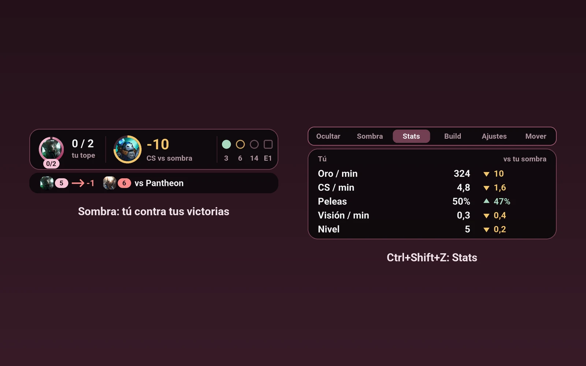
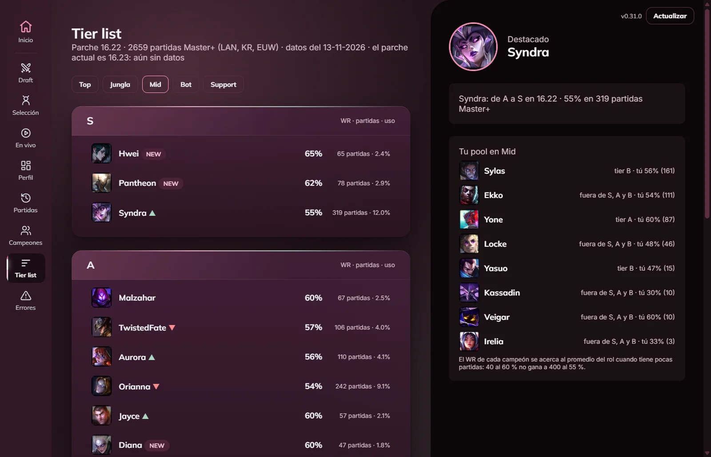

<p align="center">
  
</p>

<p align="center">
  <a href="https://github.com/C0z1/racha.gg/releases/latest"></a>
</p>

<p align="center">
  Guides tell you how a Challenger plays.<br>
  <b>Racha tells you what makes <i>you</i> lose</b>, and reminds you right when it matters.
</p>

<p align="center">
  <a href="https://racha-gg.vercel.app">Project site</a> ·
  <a href="CHANGELOG.md">What's new</a> ·
  <a href="https://c0z1.github.io/racha.gg/privacidad.html">Privacy</a> ·
  <a href="https://c0z1.github.io/racha.gg/terminos.html">Terms</a>
</p>

<p align="center">
  
</p>

## In champ select

<p align="center">
  
</p>

Your record against that opponent, your win rate with the champion, the estimate against them and **3 rules for that game**, taken from your own numbers. If you don't know who you're facing yet, Racha waits for your lane opponent to pick.

When you lock in your champion, Racha **sets its runes for you**, once: the style you used last time or the one with the best win rate. The card shows 2 or 3 styles with their win rate and games played ("Conqueror · Valor · 51% · 145 games") so you can switch with one click. It only uses the Racha page or a free slot, never yours, and if you already changed your runes it doesn't touch anything. You can turn it off in Settings.

## In game: you play against your shadow

<p align="center">
  
</p>

Your shadow is the median of your wins with that champion, minute by minute. The strip has three zones that never move: your death cap, your CS (from minute 14, your fights) against your shadow, and your 4 markers. Two markers come from your role's plan and two watch your most repeated mistakes. It speaks at most 3 times per game and never during a fight; your plan tells you how much you win when you follow it ("1 dragon by 14: you win 69%").

Press **Ctrl+Shift+Z** to make the strip clickable. In **Stats** you see your gold, CS, fights and vision per minute and your level, each with an arrow against your shadow; in **Build**, your core items with what you already bought dimmed and the next one highlighted. Only your own data: no enemy timers, no hidden information.

## After the game: your match

"Your match" tells you what you did well and what you didn't, with the minute of every death and every mistake, **why it matters** using your own games in that role ("with 1+ dragon by 14 you win 69%; without it, 27%") and **one focus for next time**. It's ready instantly, no waiting for Riot.

## What you keep repeating

<p align="center">
  
</p>

The mistakes you repeat, **with the exact minute** so you can find them in the replay, and what to try next time. No need to rewatch the whole game. Once you avoid a mistake 8 times out of 10, it's marked as fixed and the next one comes in.

## Patch tier list

<p align="center">
  
</p>

By role, the S, A and B champions of the latest patch, from Master+ games in LAN, KR and EUW. Arrows if they're rising or falling, **your champions marked with your win rate**, and it always says which patch and how many games it's based on.

## Your champions

<p align="center">
  
</p>

Who you really win with, who you struggle against, and **what to watch with each champion**.

## When you open LoL

<p align="center">
  
</p>

Your rule for today, your streak, your session and **the champion that suits you best today**.

## Why Racha

| | |
|---|---|
| **Built from your games** | No more "just farm more". Racha finds, for example, that *with 2 deaths or fewer between minutes 14 and 25 you win 65%, and with 3 or more, 44%*. |
| **Shows up on its own** | It opens when you open LoL and switches screens with each phase: champ select, game and post-game. Zero clicks. |
| **Plays fair** | It reads what the client offers to apps. The only thing it writes is the rune page, when you lock in, and only on the Racha page or a free slot (you can turn it off in Settings). No enemy timers, it doesn't play for you and it doesn't touch the game. Details in [CUMPLIMIENTO](docs/CUMPLIMIENTO.md) (Spanish). |
| **Your data is yours** | Your games live on your computer. The cloud account is optional and you delete it with one button. |

## What else it does

- **Your week**: your record against the previous week, your best champion and your worst matchup.
- **Master+ builds** for every champion, and your build compared with the top one-tricks.
- **Updates itself**, never mid-game, and checks that the installer is the original.
- **Cloud account and group leaderboard**, both optional: your settings on another PC and your win rate next to your friends'.

## FAQ

<details>
<summary><b>Can I get banned for using it?</b></summary>
<br>
Racha only <b>reads</b> the information the LoL client itself offers to apps, the same you already see on your screen. The only thing it writes is your rune page. It doesn't pick, ban, accept matches or modify the game.
</details>

<details>
<summary><b>How much does it cost?</b></summary>
<br>
It's free and open source.
</details>

<details>
<summary><b>Does it work on my server?</b></summary>
<br>
Yes: LAN, LAS, NA, EUW, KR and every other Riot server.
</details>

<details>
<summary><b>Windows says "Windows protected your PC". Is it safe?</b></summary>
<br>
That happens with new apps that don't have a digital signature yet. Click <b>More info → Run anyway</b>. The code is right here, in the open.
</details>

<details>
<summary><b>What data does it store?</b></summary>
<br>
Your games and settings live on your computer. If you turn on the cloud account, it stores your Riot ID, your settings and a summary of your games (not the full game); you delete them with one button. No MMR or ELO. Details in the <a href="https://c0z1.github.io/racha.gg/privacidad.html">privacy policy</a>.
</details>

<br>

<p align="center">
  <a href="https://github.com/C0z1/racha.gg/releases/latest"></a>
</p>

---

## How it's built

Racha is written in Python. It runs a local server and shows the window with Edge in app mode; the in-game strip is drawn with Pillow. It reads from three sources: the Riot API (with your key or your access code), the client's local API (LCU) and the Live Client Data API. The only thing it writes to the client is the rune page, when you lock in (on the Racha page or a free slot). Matchup data comes from aggregated Master+ games, with no player names.

| Folder | What's inside |
|---|---|
| [`scripts/`](scripts) | The app. `companion_web.py` starts it; `web/` holds the screens. |
| [`pruebas/`](pruebas) | Automated tests; they run on every change on Windows and Ubuntu. |
| [`backend/`](backend) | The small Cloudflare server: it stores the Riot key and the accounts. |
| [`instalador/`](instalador) | How the `.exe` and the Windows installer are built. |
| [`herramientas/`](herramientas) | Development tools that don't ship with the app. |
| [`docs/`](docs) | The website, the [user guide](docs/USO.md) (Spanish), privacy and terms. |

```bash
python scripts/companion_web.py --demo      # the app with sample data, no client needed
python -m unittest discover pruebas         # tests: no network, no key, no games
```

Internally, the app and installer are still called HTC (its old name): renaming it would break updates for people who already have it installed. PRs are welcome. [MIT](LICENSE) license.

<sub>Racha isn't endorsed by Riot Games and doesn't reflect the views or opinions of Riot Games or anyone officially involved in producing or managing Riot Games properties. Riot Games, and all associated properties are trademarks or registered trademarks of Riot Games, Inc.</sub>
