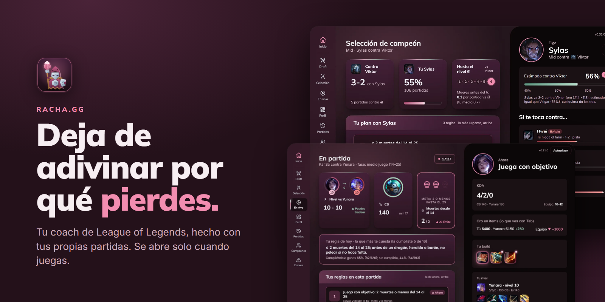
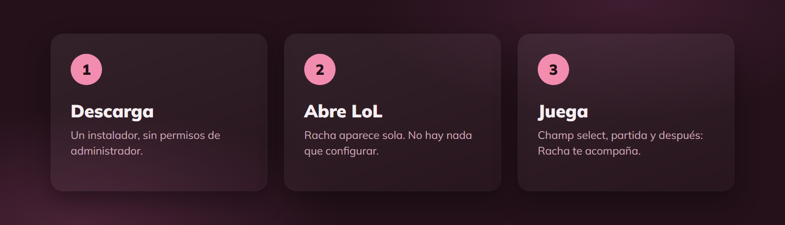
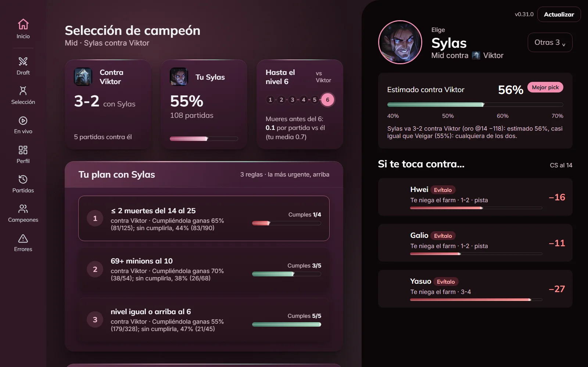
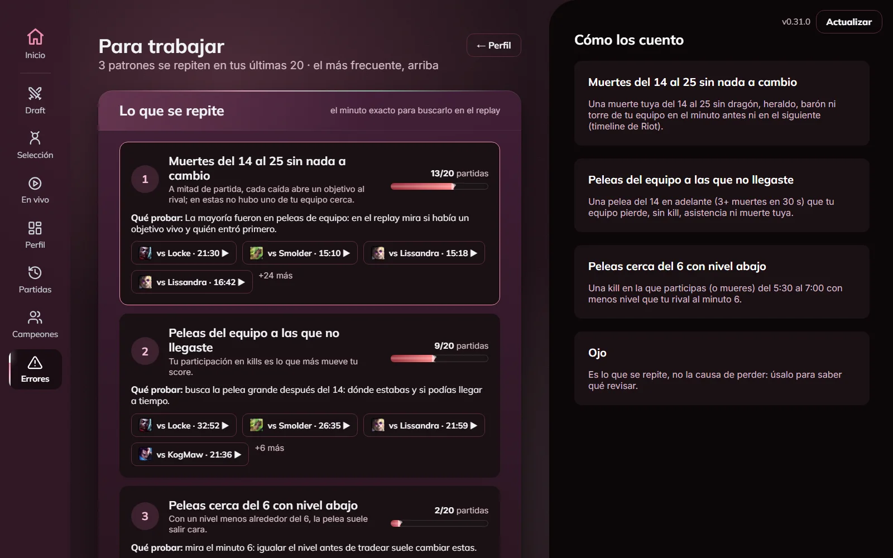
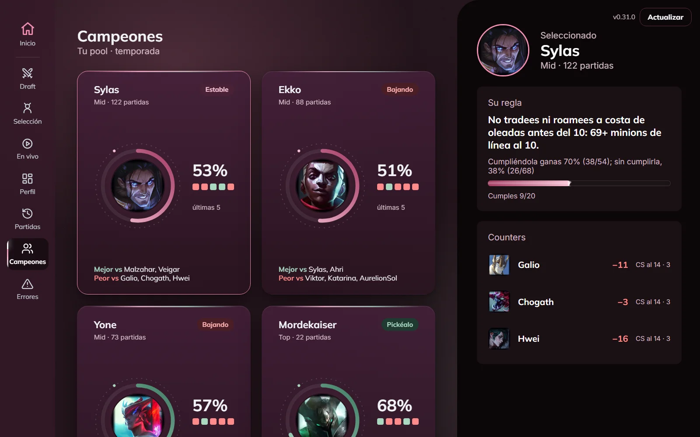
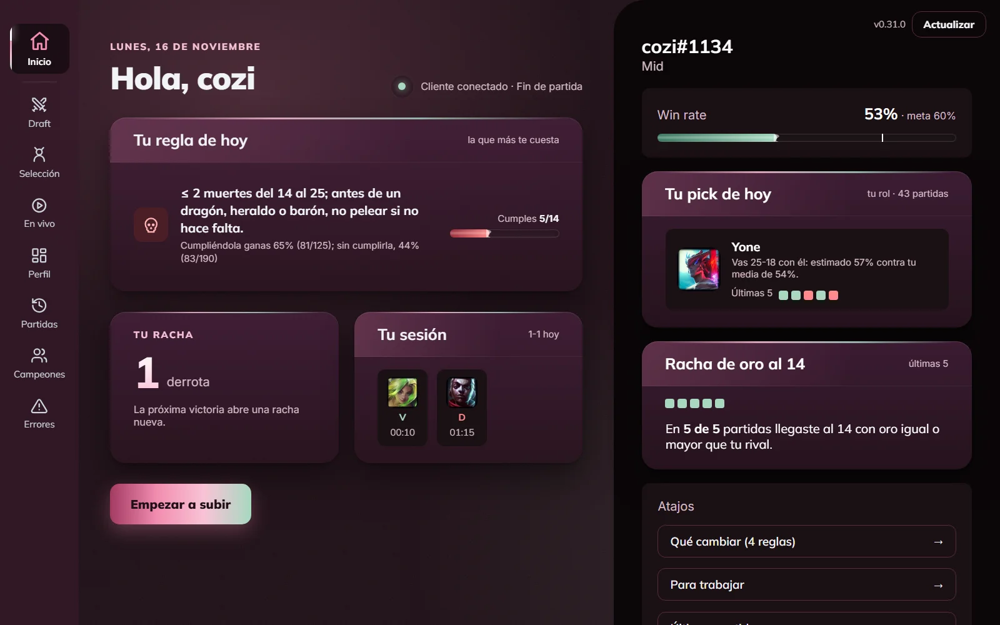

<p align="center">
  
</p>

<p align="center">
  <a href="https://github.com/C0z1/racha.gg/releases/latest"></a>
</p>

<p align="center">
  Las guías te dicen cómo juega un Challenger.<br>
  <b>Racha te dice qué te hace perder <i>a ti</i></b>, y te lo recuerda justo cuando importa.
</p>

<p align="center">
  <a href="https://racha-gg.vercel.app">Página del proyecto</a> ·
  <a href="CHANGELOG.md">Novedades</a> ·
  <a href="https://c0z1.github.io/racha.gg/privacidad.html">Privacidad</a> ·
  <a href="https://c0z1.github.io/racha.gg/terminos.html">Términos</a>
</p>

<p align="center">
  
</p>

## En champ select

<p align="center">
  
</p>

Tu récord contra ese rival, tu win rate con el campeón, el estimado contra él y **3 reglas para esa partida**, sacadas de tus números. Si aún no sabes contra quién vas, Racha espera a que tu rival de línea elija.

Al fijar tu campeón, Racha **pone sus runas sola**, una vez: el estilo que usaste la última vez o el de mejor win rate. En la tarjeta ves 2 o 3 estilos con su win rate y sus partidas («Conquistador · Valor · 51 % · 145 partidas») para cambiar con un clic. Solo usa la página de Racha o un espacio libre, nunca la tuya, y si ya cambiaste tus runas no toca nada. Se apaga en Ajustes.

## En partida: juegas contra tu sombra

<p align="center">
  
</p>

Tu sombra es la mediana de tus victorias con ese campeón, minuto a minuto. La franja tiene tres zonas que nunca cambian de lugar: tu tope de muertes, tu CS (desde el 14, tus peleas) contra tu sombra y tus 4 marcas. Dos marcas salen del plan de tu rol y dos vigilan tus errores más repetidos. Habla 3 veces por partida como mucho y nunca en una pelea; tu plan te dice cuánto ganas cuando lo cumples («≥1 dragón al 14: ganas 69%»).

Con **Ctrl+Shift+Z** la franja se vuelve clicable. En **Stats** ves tu oro, CS, peleas y visión por minuto y tu nivel, cada uno con su flecha contra tu sombra; en **Build**, tu core con lo comprado apagado y lo que sigue marcado. Solo datos tuyos: nada de timers enemigos ni información oculta.

## Al terminar: tu partida

«Tu partida» te dice qué hiciste bien y qué no, con el minuto de cada muerte y de cada error, **por qué importa** con tus propias partidas del rol («con 1 dragón o más al 14 ganas 69 %; sin él, 27 %») y **un foco para la próxima**. Sale al instante, sin esperar a Riot.

## Lo que repites

<p align="center">
  
</p>

Los errores que repites, **con el minuto exacto** para buscarlos en el replay, y qué probar la próxima vez. Nada de ver la partida entera. Cuando evitas un error 8 de cada 10 veces, queda corregido y entra el siguiente.

## Tier list del parche

<p align="center">
  
</p>

Por rol, los campeones S, A y B del último parche, con partidas Master+ de LAN, KR y EUW. Flechas si suben o bajan, **tus campeones marcados con tu win rate**, y siempre dice de qué parche y cuántas partidas son.

## Tus campeones

<p align="center">
  
</p>

Con quién ganas de verdad, contra quién sufres y **qué cuidar con cada campeón**.

## Al abrir LoL

<p align="center">
  
</p>

Tu regla de hoy, tu racha, tu sesión y **el campeón que más te conviene hoy**.

## Por qué Racha

| | |
|---|---|
| **Hecho con tus partidas** | Nada de «farmea más». Racha descubre, por ejemplo, que *con 2 muertes o menos del minuto 14 al 25 ganas el 65 %, y con 3 o más, el 44 %*. |
| **Aparece sola** | Se abre cuando abres LoL y cambia de pantalla según la fase: champ select, partida y final. Cero clics. |
| **Juego limpio** | Lee lo que el cliente ofrece a las apps. Lo único que escribe es la página de runas, al fijar campeón y solo en la página de Racha o en un espacio libre (se apaga en Ajustes). Sin timers enemigos, no juega por ti y no toca el juego. Detalle en [CUMPLIMIENTO](docs/CUMPLIMIENTO.md). |
| **Tus datos son tuyos** | Tus partidas viven en tu computadora. La cuenta en la nube es opcional y la borras con un botón. |

## Qué más trae

- **Tu semana**: tu récord frente a la semana anterior, tu mejor campeón y tu peor rival.
- **Builds de Master+** para todos los campeones, y tu build contra la de los onetricks del top.
- **Se actualiza sola**, nunca a mitad de partida, y comprueba que el instalador sea el original.
- **Cuenta en la nube y tabla del grupo**, opcionales: tus ajustes en otra PC y tu win rate junto al de tus amigos.

## Preguntas frecuentes

<details>
<summary><b>¿Me pueden banear por usarla?</b></summary>
<br>
Racha solo <b>lee</b> la información que el propio cliente de LoL ofrece a las apps, la misma que ya ves en tu pantalla. Lo único que escribe es tu página de runas. No pickea, no banea, no acepta partidas y no modifica el juego.
</details>

<details>
<summary><b>¿Cuánto cuesta?</b></summary>
<br>
Es gratis y de código abierto.
</details>

<details>
<summary><b>¿Funciona en mi servidor?</b></summary>
<br>
Sí: LAN, LAS, NA, EUW, KR y el resto de servidores de Riot.
</details>

<details>
<summary><b>Windows dice «Windows protegió su PC». ¿Es seguro?</b></summary>
<br>
Pasa con las apps nuevas que todavía no tienen firma digital. Dale a <b>Más información → Ejecutar de todas formas</b>. El código está aquí mismo, a la vista de todos.
</details>

<details>
<summary><b>¿Qué datos guarda?</b></summary>
<br>
Tus partidas y tus ajustes viven en tu computadora. Si activas la cuenta en la nube, guarda tu Riot ID, tus ajustes y un resumen de tus partidas (no la partida completa); los borras con un botón. Nada de MMR ni ELO. Los detalles están en la <a href="https://c0z1.github.io/racha.gg/privacidad.html">política de privacidad</a>.
</details>

<br>

<p align="center">
  <a href="https://github.com/C0z1/racha.gg/releases/latest"></a>
</p>

---

## Cómo está hecho

Racha está hecha en Python. Corre un servidor local y muestra la ventana con Edge en modo app; la franja en partida se dibuja con Pillow. Lee de tres fuentes: la Riot API (con tu key o tu código de acceso), la API local del cliente (LCU) y la Live Client Data API. Solo escribe en el cliente la página de runas, al fijar campeón (en la página de Racha o un espacio libre). Los datos de matchup salen de partidas Master+ agregadas, sin nombres de jugadores.

| Carpeta | Qué hay |
|---|---|
| [`scripts/`](scripts) | La app. `companion_web.py` la arranca; `web/` son las pantallas. |
| [`pruebas/`](pruebas) | Las pruebas automáticas; corren en cada cambio en Windows y Ubuntu. |
| [`backend/`](backend) | El servidor pequeño en Cloudflare: guarda la key de Riot y las cuentas. |
| [`instalador/`](instalador) | Cómo se arma el `.exe` y el instalador de Windows. |
| [`herramientas/`](herramientas) | Utilidades de desarrollo que no van en la app. |
| [`docs/`](docs) | La página web, la [guía de uso](docs/USO.md), privacidad y términos. |

```bash
python scripts/companion_web.py --demo      # la app con datos de ejemplo, sin cliente
python -m unittest discover pruebas         # pruebas: sin red, sin key, sin partidas
```

Por dentro, la app y el instalador se siguen llamando HTC (su nombre viejo): cambiarlo rompería la actualización de quien ya la tiene instalada. Los PRs son bienvenidos. Licencia [MIT](LICENSE).

<sub>Racha isn't endorsed by Riot Games and doesn't reflect the views or opinions of Riot Games or anyone officially involved in producing or managing Riot Games properties. Riot Games, and all associated properties are trademarks or registered trademarks of Riot Games, Inc.</sub>
